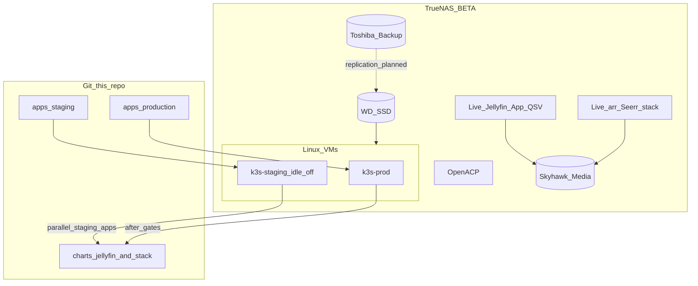

# Architecture overview

## Physical

Single TrueNAS host (i9-12900K, 31 GiB RAM, Skyhawk media, WD SSD apps/VMs, Toshiba backups). **Not physically highly available.**

## Logical (approved Topology A)

## Parallel tracks

1. **Platform:** Terraform VMs → Ansible k3s → Argo CD → Vault → observability.  
2. **Apps:** Helm charts + staging Argo Applications for Jellyfin, Seerr, *arr, qBittorrent, Navidrome, platform-smoke — developed now; reconcile when staging cluster is up.

Live Apps keep serving clients until cutover approval.
