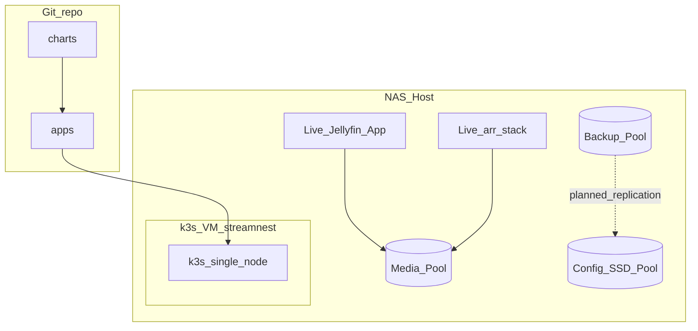

# Architecture overview

## Physical

Single NAS host running TrueNAS with a dedicated Linux VM for k3s. **Not physically highly available.** Hardware and addressing details are private.

## Logical

## Parallel tracks

1. Platform: VM → k3s → Argo CD → Vault → observability  
2. Apps: Helm charts for Jellyfin and related services on the single cluster  

Live NAS Apps serve users until cutover approval.
