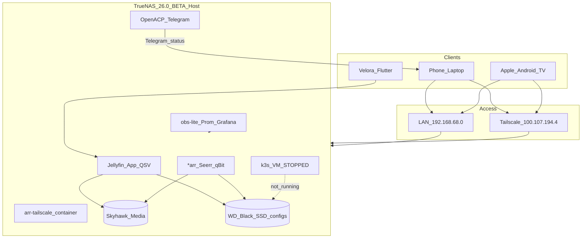

# Phase 0 — Verified discovery

**Mode:** read-only  
**Inspected:** 2026-10-23 via SSH `Host velora-nas` → `truenas_admin@192.168.68.56`  
**Not modified:** pools, datasets, apps, VMs, Jellyfin, OpenACP, network

Facts below were observed on the live host. Items under **Unknowns** were not verified or could not be read with current privileges.

---

## 1. Verified environment inventory

### 1.1 Host

| Item | Value |
|------|-------|
| Product | TrueNAS Community Edition |
| Version | `TrueNAS-26.0.0-BETA.3` |
| Hostname | `truenas` |
| Board | Gigabyte B760 GAMING X AX |
| CPU | Intel Core i9-12900K (16 physical / 24 threads), VT-x present |
| RAM | 31 GiB (`physmem` ≈ 33.4e9 bytes); swap 0 |
| ECC | false |
| Timezone | Asia/Kolkata |
| LAN | `enp4s0` → `192.168.68.56/22`, gateway `192.168.68.1` |
| Tailscale | Interface `tailscale0` = `100.107.194.4/32` (MagicDNS from existing docs: `truenas-arr.tailaf4d33.ts.net`) |
| Virtualization API | `vm.supports_virtualization` = true; legacy `vm.query` works |
| VM available memory (API) | ≈ 23.4 GiB (`vm.get_available_memory`) |

### 1.2 Utilization (snapshot)

| Metric | Observed |
|--------|----------|
| Load average | ~1.04 / 0.69 / 0.65 |
| Memory | ~14 GiB used, ~16 GiB available |
| Memory PSI | `some`/`full` avg10 ≈ 0 |
| ZFS ARC | Cap 8 GiB (POSTINIT), current size ≈ 8 GiB |
| Top RSS | Jellyfin ~882 MiB; middlewared; *arr apps; OpenACP/cursor-agent; Netdata; Prometheus |

### 1.3 Disks and pools

| Device | Model | Type | Temp (°C) | Role |
|--------|-------|------|-----------|------|
| nvme0n1 | WD_BLACK SN850X 1000GB | SSD | ~46 | Pool `WD_Black_1TB_SSD` |
| nvme1n1 | POWER X NE1000 (~128 GB) | SSD | ~58 | boot-pool |
| sda/sdb | ST4000VX016 (4 TB each) | HDD | ~36–37 | Pool `Skyhawk_8TB_HDD` (mirror/stripe as configured) |
| sdc | TOSHIBA MQ01ABD100 1 TB | HDD | ~36 | Pool `Toshiba_HDD_1TB` |

| Pool | Health | Used / Free (approx) | Purpose |
|------|--------|----------------------|---------|
| Skyhawk_8TB_HDD | ONLINE | 2.64 T / 4.61 T | Media + downloads |
| WD_Black_1TB_SSD | ONLINE | 32.4 G / 896 G | App configs, ix-apps, VMs, OpenACP |
| Toshiba_HDD_1TB | ONLINE | ~2.5 M / 928 G | Essentially empty |
| boot-pool | ONLINE | ~4 G / 114 G | OS |

Alias: `/mnt/SSD_1TB_WD` → `WD_Black_1TB_SSD`.

SMART health attributes via `smartctl` as `truenas_admin`: **permission denied** (Unknown: full SMART PASS/FAIL details). Temperatures via `disk.temperatures` succeeded.

### 1.4 Media layout (Skyhawk)

| Path | Size (approx) |
|------|----------------|
| `/mnt/Skyhawk_8TB_HDD/Media/Movies` | 2.1 T |
| `/mnt/Skyhawk_8TB_HDD/Media/TV` | 286 G |
| `/mnt/Skyhawk_8TB_HDD/Media/Music` | 140 G |
| `/mnt/Skyhawk_8TB_HDD/Media/_velora_duplicates_quarantine` | 181 G |
| `/mnt/Skyhawk_8TB_HDD/Downloads` | present (apps bind-mount) |

Empty/near-empty dataset: `Skyhawk_8TB_HDD/media` (lowercase) exists separately from `Media`.

### 1.5 Snapshots and backups

| Mechanism | Status |
|-----------|--------|
| Periodic snapshot tasks | **0 tasks** |
| Replication tasks | **none** |
| Cloud sync tasks | **none** |
| App upgrade ZFS snapshots | Present under `ix-apps/app_mounts/*` (Jellyfin, etc.) |

**Fact:** No independent backup destination is configured. Toshiba pool is a candidate but unused.

### 1.6 Virtual machines

One VM via `vm.query`:

| Field | Value |
|-------|-------|
| Name | `k3s` |
| Description | k3s observability node |
| State | **STOPPED** |
| vCPU topology | vcpus=1, cores=6, threads=1 |
| Memory | 8192 MiB |
| CPU mode | HOST-PASSTHROUGH |
| Autostart | false |
| Disk | zvol `WD_Black_1TB_SSD/vms/k3s-disk` volsize **64G** |
| NIC | virtio on `enp4s0` |
| Cloud image | Ubuntu 24.04 server cloudimg present under `vms/k3s-files/` |
| Seed | `seed.iso` + `user-data` installs k3s (Traefik disabled) + Helm |

`virt.instance.query` returned empty (Incus/LXC path unused for this VM).

**Security note:** existing `user-data` contains a plaintext VM password. Do not reuse; rotate before any start. Value intentionally omitted from this repo.

### 1.7 TrueNAS Apps and Docker workloads

**Catalog / Apps (15):**

| State | App | Image / version (human) |
|-------|-----|-------------------------|
| RUNNING | jellyfin | `ghcr.io/jellyfin/jellyfin:12.2@sha256:c3efa69a…` (12.2_1.3.21) |
| RUNNING | seerr | `ghcr.io/seerr-team/seerr:v3.5.1@sha256:d8fab…` |
| RUNNING | sonarr | `ghcr.io/home-operations/sonarr:5.0.0.2742@sha256:491f…` |
| RUNNING | radarr | `ghcr.io/home-operations/radarr:6.4.4.10685@sha256:1902…` |
| RUNNING | prowlarr | `ghcr.io/home-operations/prowlarr:2.6.5.5623@…` |
| RUNNING | bazarr | `ghcr.io/home-operations/bazarr:1.6.2@…` |
| RUNNING | qbittorrent | `ghcr.io/home-operations/qbittorrent:5.3.0@…` |
| RUNNING | navidrome | `ghcr.io/navidrome/navidrome:0.64.2@…` |
| RUNNING | metube | `ghcr.io/alexta69/metube:2026.10.22@…` |
| RUNNING | filebrowser-quantum | `ghcr.io/gtsteffaniak/filebrowser:2.0.1-stable@…` |
| RUNNING | telegram-files | `ghcr.io/jarvis2f/telegram-files:latest` (mutable tag) |
| RUNNING | feishin | `ghcr.io/jeffvli/feishin:latest` (mutable tag) |
| RUNNING | arr-dashboard | `khak1s/arr-dashboard:latest` (mutable tag) |
| STOPPED | immich | v3.2.2 |
| STOPPED | nextcloud | 35.0.1 |

**Additional Docker (Compose / custom), examples:**

- `obs-prometheus` `prom/prometheus:v2.55.1`, `obs-grafana` `grafana/grafana:11.3.0`, `obs-netdata`, `obs-cadvisor`, `obs-node-exporter`
- `adguard-home`, `vaultwarden`, `arr-tailscale` (`tailscale/tailscale:latest`), `flaresolverr`, `SuggestArr`, `tmdb-edge`

Host Netdata service also running (`:19999`).

### 1.8 Jellyfin (live)

| Item | Verified |
|------|----------|
| Runtime | TrueNAS App (Docker), not k8s |
| Image | Official `ghcr.io/jellyfin/jellyfin:12.2` pinned by digest |
| Ports | HTTP host `30013` → 8096; HTTPS host `30014` → 8920 |
| Config | `/mnt/WD_Black_1TB_SSD/configs/jellyfin` |
| Cache / transcodes | ix-apps mounts under `WD_Black_1TB_SSD/ix-apps/app_mounts/jellyfin/` |
| Media | `/mnt/Skyhawk_8TB_HDD/Media` → `/media` (**read-write**) |
| Downloads | `/mnt/Skyhawk_8TB_HDD/Downloads` → `/downloads` |
| UID/GID | 568:568 (`apps`) |
| Limits | 6 CPUs, 4096 MiB memory |
| GPU | `resources.gpus.use_all_gpus: true`; container Devices mount `/dev/dri` |
| iGPU | PCI `00:02.0` Intel AlderLake-S GT1; `/dev/dri/card0` + `renderD128` |
| FFmpeg | jellyfin-ffmpeg present; **h264_qsv / hevc_qsv / vaapi** encoders listed inside container |
| Transcode *runtime* test | **Not executed** in Phase 0 (would be a live workload test) |

### 1.9 Networking / remote access

| Item | Fact |
|------|------|
| LAN SSH | Works (`velora-nas` key auth) |
| Tailscale IP | `100.107.194.4` on host |
| Documented MagicDNS | `truenas-arr.tailaf4d33.ts.net` (from `truenas-arr` docs) |
| DNS | resolv uses `192.168.68.56` then `1.1.1.1` (AdGuard likely local) |
| Public admin exposure | Apps bound `0.0.0.0` on many ports — rely on LAN/Tailscale, not Internet ACLs verified here |
| `tailscale` CLI on NAS PATH | Not found for admin user; status via CLI **unknown** (interface present) |

### 1.10 NAS AI agents

#### OpenACP (primary Telegram agent) — running

| Item | Fact |
|------|------|
| Dataset | `/mnt/WD_Black_1TB_SSD/openacp` (also via `/mnt/SSD_1TB_WD/openacp`) |
| Runtime | Node 22 + `openacp` daemon; Cursor agent binary ACP mode |
| Persistence | POSTINIT `postinit-start.sh`; cron watchdog every 5 min |
| Telegram | Plugin enabled; chat restricted via `allowedUserIds` |
| Cursor args | `--model auto --force --trust --auto-review --sandbox disabled` |
| Secrets | `.env` keys: `CURSOR_API_KEY`, `TELEGRAM_*` (values not copied) |

#### Velora agent — cron mostly OFF

Python agent at `/mnt/WD_Black_1TB_SSD/configs/velora-agent/` for Seerr/release automation and local HTTP `:8765`. Cron entries for serve/daily are **OFF** per OpenACP inventory summary.

### 1.11 Related repositories (laptop)

| Path | Notes |
|------|-------|
| `~/Media_Streaming_Platform` | This repo — empty until Phase 0 docs |
| `~/truenas-arr` | Git `ravikishore-m/truenas-arr-stack`, Compose/catalog deploy CLI |
| `~/Velora` | Flutter client (Dockerfile exists; client-focused) |
| `~/Jellyfin-tvos`, `~/jellyfin-androidtv` | Native clients |
| Cursor plan | Prior hybrid plan kept Jellyfin on Apps; k3s for observability (VM created, Helm mostly cancelled) |

---

## 2. Current-state architecture

**Physical HA:** single host — not physically highly available.

---

## 3. Proposed production / staging Kubernetes topology

### 3.1 Target (preferred if approved)

| Env | Form | Disk | Notes |
|-----|------|------|-------|
| Staging | Dedicated Linux VM + single-node k3s | WD SSD zvol | Candidate images, rollout failure tests, no prod secrets/data writes |
| Production | Dedicated Linux VM + single-node k3s | WD SSD zvol | Reviewed digests only; approval gates |

Do **not** silently replace with namespaces. Namespaces-only is an explicit fallback requiring approval.

### 3.2 Resource feasibility (honest)

**Host budget (approx, GiB):**

| Reservation | GiB |
|-------------|-----|
| ZFS ARC (current cap) | 8 |
| Jellyfin limit | 4 |
| *arr + Seerr + qBit + others (RSS ballpark) | 3–5 |
| OpenACP + Cursor | ~0.5–1 |
| obs-lite / Netdata / Prometheus | ~1–2 |
| TrueNAS OS / middleware | ~2–3 |
| **Subtotal host (Jellynfin stays on Apps)** | **~19–23** |
| Physical RAM | **31** |
| API “available for VMs” | **~23** (optimistic; contends with above) |

**Existing VM:** 8 GiB RAM / 6 cores / 64 G disk (stopped).

**Dual always-on draft:**

| VM | vCPU | RAM | Disk |
|----|------|-----|------|
| k3s-staging | 4 | 4–6 GiB | 64 G |
| k3s-prod | 6 | 8 GiB | 80–100 G |
| **Combined VM RAM** | | **12–14 GiB** | |

Running **both** VMs plus current host stack approaches or exceeds comfort headroom under stream+transcode load. Memory PSI is currently zero only because the k3s VM is stopped.

**Recommended options for approval:**

1. **A — Dual clusters, staging idle-off:** keep separate VMs; autostart only prod; start staging for CI/validation windows.
2. **B — Dual clusters, shrink staging to 4 GiB / 2–4 vCPU** and freeze non-essential STOPPED apps (Immich/Nextcloud stay off).
3. **C — Single cluster first (staging-only VM),** add production VM after measured headroom — still separate clusters, sequenced.
4. **D — Namespace isolation on one cluster** — only if you explicitly reject dual VMs after seeing the numbers.

SSD free ≈ **867 GiB** — disk capacity is **not** the blocker; **RAM** is.

### 3.3 What stays on the host initially

Until staging acceptance + explicit cutover approval:

- Live Jellyfin (QSV proven on host `/dev/dri`)
- Media datasets on Skyhawk
- OpenACP
- Existing *arr stack (migration optional, later waves)

k8s first wave should be platform services + a disposable smoke app, then Jellyfin **staging** with NFS/SMB/hostPath design that does not touch prod config datasets.

---

## 4. Container image inventory

| Workload | Class | Source | Pinning today | k8s target |
|----------|-------|--------|---------------|------------|
| Jellyfin | Official upstream | `ghcr.io/jellyfin/jellyfin` | Tag 12.2 + digest | Prefer same official image by digest |
| Seerr | Official/community | `ghcr.io/seerr-team/seerr` | Tag + digest | Optional later |
| Sonarr/Radarr/Prowlarr/Bazarr/qBit | Verified community | `ghcr.io/home-operations/*` | Tag + digest | Optional later |
| Navidrome | Official | `ghcr.io/navidrome/navidrome` | Tag + digest | Optional later |
| Prometheus/Grafana | Official | `prom/*`, `grafana/*` | Version tags | Helm in k8s |
| Vault | Official | HashiCorp (verify chart/image) | TBD Phase 8 | Custom deploy |
| Argo CD | Official | quay.io/argoproj | TBD Phase 5 | Helm |
| Platform smoke / APIs | Custom | Build → GHCR | None yet | Required for CI proof |
| telegram-files / feishin / arr-dashboard | Community | `latest` tags | **Weak** | Pin digests or replace |
| Velora / tvOS / Android TV | Client apps | N/A | N/A | Not server containers; connect via Tailscale/LAN to Jellyfin service |

**Policy reminder:** do not rebuild Jellyfin from source without a documented need; promote one digest staging → prod.

---

## 5. WD SSD and resource feasibility report

| Check | Result |
|-------|--------|
| Model | WD_BLACK SN850X 1000GB (`nvme0n1`) |
| Pool | `WD_Black_1TB_SSD` ONLINE, ~3% capacity used |
| Free | ≈ 867 GiB available |
| Current uses | ix-apps/docker ~20 G, configs ~6 G, jellyfin cache ~2.4 G, openacp, vms/k3s-disk 64 G zvol |
| Safe for platform VMs / PVCs? | **Yes for capacity**, subject to quotas so observability does not fill the pool |
| Media on SSD? | No — media remains on Skyhawk |
| Health | Temps OK; full SMART health **unknown** (permission) |

**Do not** allocate entire SSD to Kubernetes. Propose dataset quotas in Phase 1 ADR.

---

## 6. Terraform provider and VM feasibility

| Question | Finding |
|----------|---------|
| TrueNAS version compatible? | Host is **26.0.0-BETA.3**; official provider documents support for **25.10 and 26.0** |
| Provider | `truenas/truenas` (official), WebSocket `/api/current`, Terraform ≥ 1.11 |
| VM resources | `truenas_vm`, `truenas_vm_device`, datasets/zvols supported |
| Existing VM API | `vm.*` methods present and populated |
| Incus `virt.instance` | Empty here; k3s VM is classic `vm` subsystem |
| Apply in Phase 0? | **No** — plan-only after approval |
| Risk | BETA OS + new provider: prefer non-prod apply first; never PR-auto-apply production |

If provider gaps appear against this exact build, document ADR and fall back to API/manual with honesty — do not fake Terraform management.

Ansible remains for **guest** OS/k3s bootstrap, not for creating TrueNAS zvols that Terraform owns.

---

## 7. Security and recovery risk assessment

| Risk | Severity | Notes |
|------|----------|-------|
| Single physical host | High (availability) | No HA claim |
| TrueNAS BETA | High | Platform instability risk |
| No independent backups | **Critical** | No replication/cloudsync/periodic snapshots |
| OpenACP `--sandbox disabled --force --trust` | High | Broad agent power on NAS |
| Plaintext password in k3s `user-data` | High | Rotate before VM use |
| Mutable `:latest` images | Medium | telegram-files, feishin, arr-dashboard, arr-tailscale |
| App ports on `0.0.0.0` | Medium | Mitigated by Tailscale/LAN assumption; verify no WAN forward |
| Jellyfin media mount RW | Medium | Prefer RO media in k8s staging design |
| Non-ECC RAM | Medium | Accept for home lab; note for portfolio honesty |
| Midnight reboot cron | Medium | Ops surprise during long migrations |
| kubeconfig on host dataset | Medium | Protect; never commit |
| Vault not present | — | To be introduced later; no dependency yet |

**Recovery today:** ZFS app-upgrade snapshots only. Host/SSD failure → media on Skyhawk may survive; app configs on WD SSD at risk without backup copy to Toshiba/offsite.

---

## 8. Unknowns (explicit)

- Full SMART PASS/FAIL and wear metrics for SN850X (need privileged read).
- Whether QSV works **inside** a VM with iGPU passthrough or mediated devices (untested).
- Whether existing k3s VM disk has a healthy Ubuntu/k3s install or only cloud-init prep.
- Tailscale ACL / exit-node / subnet-router details (CLI not available to admin user).
- Firewall / router WAN port-forward rules.
- Whether AdGuard is sole DNS for LAN clients.
- Exact Vault/Argo versions to pin (deferred to later phases).
- GitHub org/permissions for GHCR + Actions on this new repo (not created yet).

---

## 9. Approval-required decisions

See also `docs/PROJECT_STATUS.md`. Short list:

1. Dual-VM topology option A/B/C/D  
2. Keep live Jellyfin on Apps until staging proof  
3. QSV strategy for eventual k8s Jellyfin  
4. Stay on BETA vs wait for stable TrueNAS  
5. Designate Toshiba (or other) as backup target and enable periodic snapshots  
6. Approve creating git remote for this repository  
7. Wave-1 app scope  
8. OpenACP hardening before k8s remediation hooks  
9. Credential rotation for existing k3s cloud-init  

---

## 10. Phase 1 plan (architecture only — no apply)

1. Write ADRs: isolation model, Terraform vs Ansible vs GitOps ownership, SSD quotas, backup destination, Jellyfin freeze.  
2. Install Terraform locally; configure provider against API key (secret in env, not git); `terraform plan` only for a staging VM module.  
3. Produce final RAM/CPU spreadsheet with “streaming protected” guardrails.  
4. Draft `docs/architecture/service-integration-matrix.md` skeleton from discovered ports.  
5. Decide image promotion + GHCR naming.  
6. Stop for approval before Phase 2 (repo/CI foundation) or Phase 3 (provision).

---

## 11. Commands run (representative, read-only)

- `ssh velora-nas` + `midclt call system.info|version|product_type|disk.query|pool.query|vm.query|app.query|app.config jellyfin|vm.get_available_memory|…`
- `free`, `lscpu`, `zpool list`, `zfs list`, `ip`, `ss`, `docker ps/inspect/exec` (Jellyfin `/dev/dri` + ffmpeg encoders)
- Local: SSH config, related repo READMEs, Terraform provider documentation (web)

No `terraform apply`, no `vm.start`, no dataset create/destroy, no app restart, no package install.
